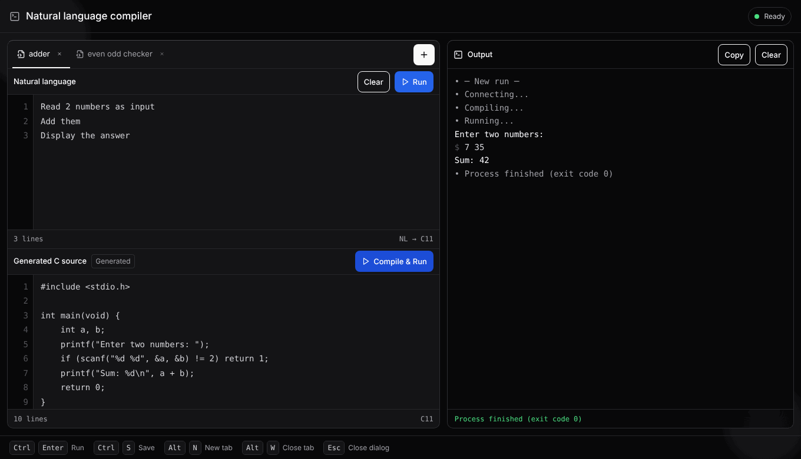

# Natural Language → C Compiler

Type the steps of a program in plain English, one per line:

```text
Read 2 numbers as input
Add them
Display the answer
```

Press **Run** and a local AI model (Qwen3-4B, running on your own computer with
llama.cpp) writes the C program. Press **Compile & Run** and it is compiled
with gcc and run, with an interactive terminal for its input and output.



## 1. Install these once

**Windows:** open **PowerShell** and run these one at a time (each takes a
minute or two; say **Yes** if Windows asks for permission):

```powershell
winget install OpenJS.NodeJS.LTS
winget install Python.Python.3.12
winget install Git.Git
winget install llama.cpp
winget install MSYS2.MSYS2
C:\msys64\usr\bin\bash.exe -lc "pacman -Sy --noconfirm mingw-w64-ucrt-x86_64-gcc"
```

| program | why the app needs it |
| --- | --- |
| **Node.js** (LTS) | runs `npm run dev` and the web page |
| **Python** 3.11 or newer | runs the backend |
| **Git** | downloads the project |
| **llama.cpp** | runs the AI model (Qwen3 4B) |
| **MSYS2** + the last line | installs **gcc**, which compiles the C code. The app finds it in `C:\msys64` by itself |

Then **close and reopen PowerShell / VS Code** so it sees the new programs,
and check:

```powershell
node --version
py --version
git --version
llama-server --version
```

Each should print a version number. If one says "not recognized", install it
again or restart the computer.

**Linux / macOS:** install the same programs with your package manager:
`brew install node python git llama.cpp` on macOS (gcc comes with
`xcode-select --install`), or `sudo apt install nodejs npm python3 python3-venv gcc git`
on Ubuntu plus [llama.cpp](https://github.com/ggml-org/llama.cpp).

## 2. Get the project

```powershell
git clone -b backend https://github.com/Kavin-x-x-Kumaran/natural-language-compiler
cd natural-language-compiler
```

`-b backend` matters: the working app is on the **`backend`** branch.

**Already have an older copy?** Update it instead (inside its folder):

```powershell
git fetch origin
git switch backend
git pull origin backend
```

`git branch --show-current` should print `backend`. If `npm run dev` says
**Missing script: "dev"**, you are still on the old `main` branch.

## 3. Run it

1. In VS Code: **File → Open Folder…** and choose the `natural-language-compiler`
   folder.
2. **Terminal → New Terminal**, and run:

   ```bash
   npm run dev
   ```

   That one command starts everything: the AI model (llama-server with
   Qwen3 4B), the backend and the web page. Your browser opens
   **http://localhost:5173**, and the terminal prints **"The AI model is
   ready"** when **Run** can be used. It then tests the model once with the
   adder example and prints **"AI model test passed"** (this also warms the
   model up, so your first **Run** is faster).

   The first time takes longer: it sets up Python and the web page (a few
   minutes) and downloads the AI model (about 2.5 GB).

To stop everything, press **Ctrl+C** in that terminal.

<details>
<summary>Other ways to run the AI model</summary>

- **Your own model file:** put `LLAMA_MODEL_FILE=C:/path/to/model.gguf` in
  `backend/.env` (copy it from `backend/.env.example`).
- **Start llama-server yourself** (e.g. with extra options): run it in another
  terminal before `npm run dev`, which then uses it as it is:

  ```bash
  llama-server -hf Qwen/Qwen3-4B-GGUF:Q4_K_M --port 8080 -c 8192 -np 1 --jinja
  ```

- **[Ollama](https://ollama.com):** if llama.cpp is not installed but Ollama
  has a Qwen model (`ollama list`), the app uses Ollama instead (it prefers
  `qwen3:4b`).

</details>

## 4. Use it

1. Write steps in **Natural language** (or use the two example tabs).
2. Press **Run**. The C code appears under **Generated C source**.
3. Press **Compile & Run**. Output appears on the right. When the program asks
   for input, type it in the box at the bottom of the Output panel and press
   **Enter**.

The chip in the top-right corner shows what is working:

| chip | meaning |
| --- | --- |
| **Ready** (green) | everything is running |
| **AI model not running** (amber) | Compile & Run works. **Run** needs the AI model: wait for "The AI model is ready" in the terminal, or install llama.cpp (step 1) |
| **Backend not running** (red) | start the app with `npm run dev` |

## Troubleshooting

| you see | do this |
| --- | --- |
| `npm.ps1 cannot be loaded … running scripts is disabled` | Open a new terminal: this project sets VS Code to use Command Prompt, which avoids it. Or run once in PowerShell: `Set-ExecutionPolicy -Scope CurrentUser RemoteSigned` |
| `Python 3.11 or newer was not found` | Install Python (step 1), then close and reopen VS Code |
| `gcc (the C compiler) was not found` | Run the MSYS2 lines from step 1, then restart `npm run dev` |
| `Missing script: "dev"` | You are on the old `main` branch: see "Already have an older copy?" in step 2 |
| `The AI model is not running` | Wait for "The AI model is ready" in the `npm run dev` terminal. If it says the model stopped, see `llama-server.log` |
| `The AI model is still loading` | Wait for "The AI model is ready" in the terminal, then press **Run** again |
| `AI model test failed` in the terminal | The model is not answering properly: check `llama-server.log`, and that it is Qwen3 4B (the default) |
| `The answer was cut off` | You started llama-server yourself without `-np 1`: use the command under "Other ways to run the AI model" |
| `Port 8000 is already in use` | The app is already running in another terminal; use that one or stop it with Ctrl+C |
| `llama-server` is not recognized | Reopen VS Code after `winget install`, or download a Windows build from [llama.cpp releases](https://github.com/ggml-org/llama.cpp/releases) |
| **Run** is slow | Normal on a laptop CPU: generation can take 30–60 seconds |

## What is in this repository

| path | contents |
| --- | --- |
| `frontend/` | React + Vite web UI. See [`frontend/README.md`](frontend/README.md) |
| `backend/` | FastAPI service: talks to the model and compiles/runs C with gcc. See [`backend/README.md`](backend/README.md) |
| `scripts/dev.mjs` | what `npm run dev` runs: sets up Python, starts the AI model, backend and frontend |
| `requirements.txt` | the backend's Python packages |

**Safety note:** the app compiles and runs the generated C on your computer,
with time, memory and output limits, but these limits are not a sandbox. Run
it on your own machine, not as a public service. See
[`backend/README.md`](backend/README.md#security-considerations).
